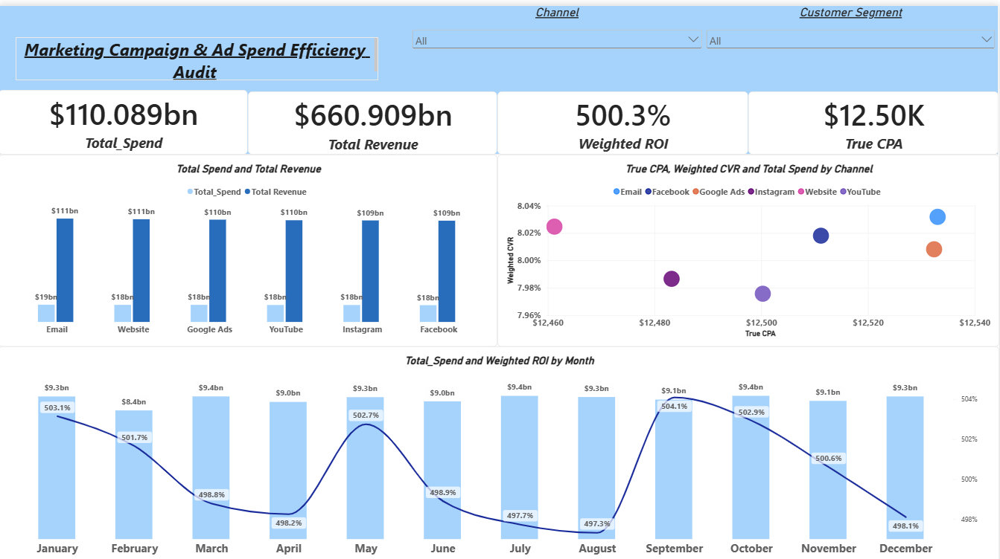

# Marketing Campaign & Ad Spend Efficiency Audit (Power BI)

An end-to-end marketing performance and capital efficiency dashboard built in Power BI to evaluate multi-channel customer acquisition cost (CPA), conversion efficiency, and return on investment across customer segments.

## Executive Summary & Headline Metrics
Across all tracked campaigns, marketing spend generated strong top-line return with tightly clustered efficiency across digital channels:
* **Total Ad Spend:** $110.09B
* **Total Estimated Revenue:** $660.91B
* **Weighted ROI:** 500.3% (6.00x ROAS)
* **True Cost Per Acquisition (CPA):** $12.50K
* **Weighted Conversion Rate (CVR):** ~8.00%

## Key Analytical Insights
1. **Channel Efficiency Quadrant (Website vs. Email):** While **Email** drove the highest total volume (~$19B spend generating ~$111B in revenue), **Website** campaigns achieved the strongest unit economics—delivering the lowest True CPA (~$12,462) alongside one of the highest Weighted CVRs (~8.03%).
2. **Volume vs. Cost Trade-Off:** **Email** and **Google Ads** experienced slightly higher acquisition costs (~$12,533 CPA) compared to **Website** and **Instagram**, indicating opportunities to test bid caps on high-volume paid search and email segments.
3. **Seasonal ROI Performance:** Monthly spend remained steady between **$8.4B and $9.4B**, while Weighted ROI fluctuated within a tight **497.3%–504.1%** band—peaking in **September (504.1%)** and **January (503.1%)** and dipping slightly in **August (497.3%)**.

## Data Modeling & DAX Methodology
Rather than relying on unweighted row-level averages—which distort performance when campaign sizes vary—all core metrics were engineered as weighted DAX measures inside a dedicated `_Measures` table:

* **Total Conversions:** `SUM('marketing_campaign_dataset'[Conversions])`
* **Total Spend:** `SUM('marketing_campaign_dataset'[Total_Spend])`
* **Total Revenue:** `SUM('marketing_campaign_dataset'[Est_Revenue])`
* **Weighted CVR:** `DIVIDE([Total Conversions], SUM('marketing_campaign_dataset'[Clicks]), 0)`
* **True CPA:** `DIVIDE([Total Spend], [Total Conversions], 0)`
* **Weighted ROI:** `DIVIDE([Total Revenue] - [Total Spend], [Total Spend], 0)`

## Dataset Context & Analytical Notes
* **Source:** Multi-channel marketing campaign dataset containing impressions, clicks, conversion rates, acquisition costs, ROI, and audience segments.
* **Scale & Assumptions:** The underlying dataset reflects synthetic enterprise/B2B-scale acquisition costs ($5,000–$20,000 per conversion). Total spend and estimated revenue were derived at the campaign grain prior to aggregation so that high-volume campaigns carry accurate statistical weight in all KPI calculations.

## Repository Structure
* `Dashboard Marketing Analytics.pbix` — Complete Power BI Desktop report and DAX data model
* `dashboard_preview.png` — High-resolution export of the interactive report view
* `README.md` — Project documentation, methodology, and findings
